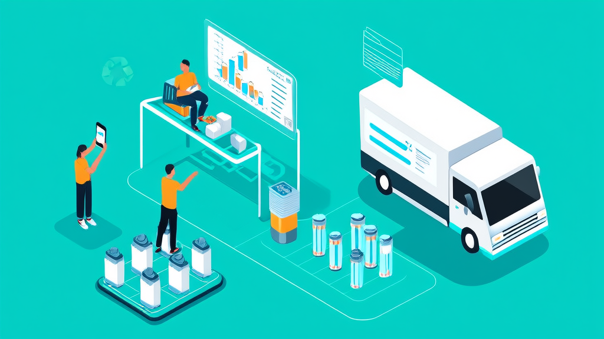

# 废旧电池回收小程序，废品上门回收软件

**废旧电池回收系统案例：上门回收预约、派单结算与台账管理_讯业信息**

环保/再生资源回收（电池回收与销售） · 河南讯业信息科技有限公司

[📖 在线预览](https://xunyeit.github.io/fei-jiu-dian-chi-hui-shou-xiao-cheng-xu-fei-pin-shang-men-hu/) · [🌐 公司官网](https://www.xunyeit.com) · [💼 更多案例](https://cms.xunyeit.com/)

---

## 案例摘要

某电池销售与回收企业通过讯业信息搭建的电池回收平台，把新品电池下单上门安装与废旧电池按年限、规格预约回收统一到用户端、回收员端与管理后台三端一体的系统中，实现废旧电池上门回收预约、回收订单派单结算与电池回收台账管理的全流程线上化。平台上线后，订单状态（等待上门、回收中、完成回收）对用户透明可查，新旧电池价格与产品上下线在后台统一配置并同步前端，入库、出库、库存台账与回收总量、营收、用户量报表可逐项核对。该案例为电池销售与回收一体业务提供了“以旧换新+上门回收+台账合规”的可复制数字化范式。

## 关键成果

| 指标 | 成果 |
|---|---|
| 电池回收平台采用用户端、回收员端与管理后台三端一体架构，覆盖新品电池下单上门安装与废旧电池按年限、规格预约回收 | 3 端一体 |
| 回收订单状态被离散化为等待上门、回收中、完成回收三个节点，并按全部/等待上门/回收中/完成回收四类视图呈现 | 3 个状态节点 + 4 类订单视图 |
| 新旧电池价格调整与产品上下线统一在电池回收管理后台配置，前端展示随后台同步生效 | 1 处配置、前端同步 |
| 钱包提现采用“后台审核+财务线下打款”两段式流程，审核与打款节点全部留痕 | 2 段式资金流程 |
| 管理员与回收员差异化权限配置，派单、结算、台账等敏感操作收敛至管理后台 | 2 类角色权限隔离 |
| 系统输出回收总量、营收、用户量与回收统计四类报表，并形成入库、出库、库存三类台账 | 4 类经营报表 + 3 类库存台账 |

# 废旧电池回收系统案例：上门回收预约、派单结算与台账管理如何打通

> **结论摘要**：某电池销售与回收企业通过讯业信息搭建的电池回收平台，把“新品电池下单—上门安装—旧电回收—派单结算—入库台账”统一到用户端、回收员端与管理后台三端一体的系统中。平台上线后，废旧电池上门回收预约、回收订单派单结算与电池回收台账管理全部线上留痕，订单状态对用户透明可查，新旧电池价格与产品上下线在后台统一管控。对同类企业而言，这是一套可复制的“以旧换新+上门回收+台账合规”数字化范式。

## 开篇摘要：一套系统打通用户预约、回收员派单与管理后台台账

某电池销售与回收企业通过讯业信息搭建的电池回收平台，把新品电池下单上门安装与废旧电池按年限、规格预约回收统一到同一套系统，覆盖用户端、回收员端与管理后台。

平台上线后，回收订单从预约、派单、回收到结算全流程线上留痕，订单状态（待上门、回收中、完成回收）对用户透明可查。后台同时实现新旧电池价格上下线与调价的统一管控，并建立入库、出库、库存台账与回收统计报表。对这家企业而言，废旧电池回收业务由此从依赖电话与人工协调，转向可配置、可追溯的系统化管理。

## 行业背景与挑战：电池销售与废旧电池回收为何需要线上化

电池销售与废旧电池回收是两个高度关联却长期割裂的场景。销售端已经习惯线上化，回收端却仍大量依赖电话、微信等分散渠道：用户不清楚该找谁预约，回收员与订单之间也缺少统一的调度枢纽。

随着以旧换新与上门服务成为消费习惯，问题被进一步放大。企业如果没有面向用户的线上入口，也没有后台台账，既接不住增量订单，也难以核算回收物资与营收——哪些电池收回来了、什么时候入库、当期回收总量多少，往往要靠事后补录与人工对账。

电池回收线上化面临的几项行业共性挑战：

- **价格波动频繁**：新旧电池的回收价与销售价随行情调整，前端展示与后台配置容易出现不一致。
- **产品型号规格多**：不同年限、不同规格的电池回收标准不同，需要结构化采集而非口头描述。
- **库存与回收量需要可追溯**：入库、出库、库存三项数据必须能对应到具体订单，否则台账失去意义。

与此同时，监管与用户对环保合规、隐私协议与回收流向透明度的关注度持续提升，回收业务不再只是“把旧电池收走”，而是一套需要留痕、可审计的流程。

这些问题共同指向一个结论：电池回收业务需要的不是零散工具，而是一套覆盖上门回收预约、回收订单派单结算与电池回收台账管理的完整系统。

## 常见问题

**废旧电池回收系统一般包含哪些功能模块？**

典型配置包含三端：用户端（后台可控首页、立即回收预约、订单与个人中心）、回收员端（接单、完成订单、提交结算）和管理后台（派单、订单筛选导出统计、新旧电池价格与上下线配置、入库出库库存台账、管理员与回收员差异化权限）。本案的电池回收平台由讯业信息按此架构搭建。

**废旧电池如何预约上门回收？**

用户在“立即回收”模块填写地址定位、上门时间、产品规格型号（支持拍照上传）与联系人信息后提交，系统生成结构化回收订单，再由管理后台派单给指定回收员上门，回收员上门前即可依据规格与照片判断电池类型和处理方式。

**回收订单的派单和结算怎么处理？**

由电池回收管理后台指定回收员派单，回收员上门完成订单后提交结算。订单状态分为等待上门、回收中、完成回收三类，并支持按全部、等待上门、回收中、完成回收四类视图筛选、导出与统计，异常订单可在后台即时处理与改价。

**电池回收价格和产品上下线能否随时调整？**

可以。新旧电池产品的上线与价格调整统一在电池回收管理后台配置，前端展示随后台同步生效，行情变动只需在一处修改，避免前后端价格不一致导致的以旧换新报价纠纷。

**回收物资的库存台账如何管理？**

各类电池的入库、出库与库存均在后台形成台账，并可逐项核对到具体订单；系统同时输出回收总量、营收、用户量与回收统计报表，为价格策略与备货计划提供数据依据。管理员与回收员按权限差异化操作，派单、结算、台账等敏感动作均有记录可查。

**钱包余额提现如何到账？**

用户在个人中心发起提现，经后台审核通过后由财务线下打款，采用“后台审核+财务线下打款”两段式流程，审核与打款节点全部留痕，兼顾业务灵活性与资金合规。

## 关于 河南讯业信息科技有限公司

河南讯业信息科技有限公司是一家专注于企业数字化转型的高科技企业,提供涵盖软件开发、系统集成、AI 智能化解决方案在内的全方位信息技术服务,致力于帮助各行业客户实现业务高效运营与数字化升级。

## 联系我们

- 公司官网:[https://www.xunyeit.com](https://www.xunyeit.com)
- 案例库:[https://cms.xunyeit.com/](https://cms.xunyeit.com/)
- 交流电话:15538271057(微信同号)

> 关键词:电池回收、废旧电池回收系统、上门回收预约、电池回收管理后台、回收订单派单结算、电池回收台账管理、以旧换新电池、讯业信息
